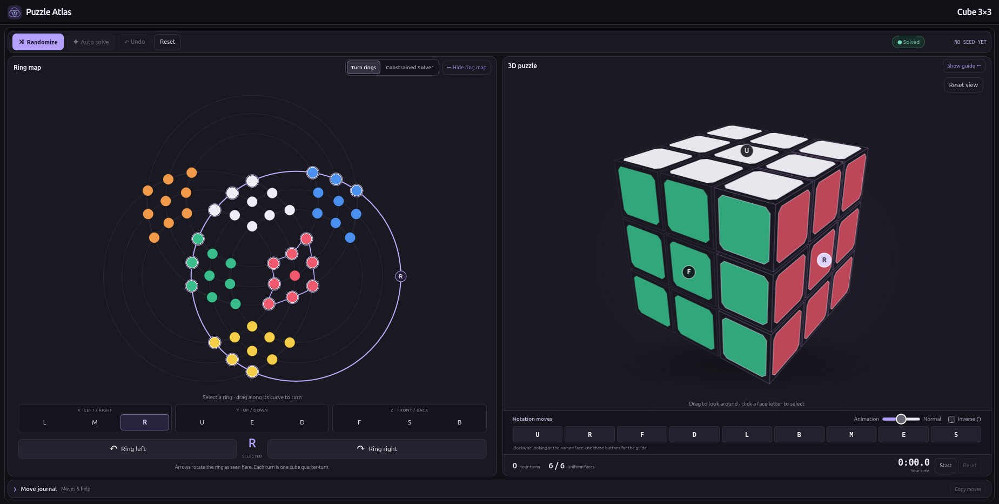

# Puzzle Atlas

An interactive atlas of puzzles, with 3D views, ring maps, detailed solution guides, and browser-based solvers powered by permutation groups and stabilizer chains.

**[Play Puzzle Atlas](https://luke-a-wendt.github.io/puzzle-atlas/)**

Explore a puzzle in three dimensions, follow its moves on a ring map, or experiment with solving selected pieces while preserving others.

## Features

- **34 playable puzzles:** cubes from 2×2×2 through 8×8×8, tetrahedral puzzles, corner-turning puzzles, dodecahedral puzzles, shape-changing variants, and a hidden bonus puzzle.
- **Interactive 3D views:** rotate the camera, select a turning axis, and watch legal moves animate.
- **Ring maps:** colored nodes show the current sticker arrangement, while highlighted paths show which nodes move with the selected axis.
- **Constrained Solver:** select nodes to hold and a pair to exchange, then execute a verified legal sequence.
- **Auto Solve:** solve the current configuration without reversing the move journal, with visible progress and secured-node highlighting.
- **Built-in guides:** puzzle-specific instructions, notation, algorithms, references, and an expandable technical explanation of the shared solver.
- **Optional mirror mode:** use shape instead of color on supported irregular puzzles; the ring map is hidden in this mode.
- **Responsive dark interface:** collapsible ring-map and guide panels, animation controls, a manual timer, scrambling, and Undo.

All puzzle simulation, rendering, and solving run in the visitor’s browser. Playing requires **no AI tokens, model API calls, account, or API key**. Hosting serves the static files and solver tables.

## Getting started

1. Choose a puzzle from the atlas.
2. Use **Randomize** to apply a new scramble to its current configuration.
3. Select an axis and turn using the move buttons or ring controls.
4. Open **Show guide** for the puzzle’s solution instructions.
5. Try **Auto Solve** to watch a verified solution execute in stages.

Dragging the 3D view changes the camera, not the puzzle state. The ring map opens by default and can be hidden when you want more room for the 3D puzzle.

## Constrained Solver

Switch the ring map from **Turn rings** to **Constrained Solver**:

1. Use **Select holds** or **Deselect holds**, then click or lasso nodes.
2. Choose **A**, then **B**, from the available nodes.
3. Press **Go** to find and animate their exchange.

Held nodes return to their original positions **after the complete sequence**; they may move temporarily during playback. Other unheld nodes may also move.

Dimmed nodes indicate proved-impossible choices under the current constraints and legal moves. B choices additionally depend on A. Some nodes, such as fixed centers or stickers that can only cycle in threes, cannot exchange as a pair even with no holds.

Choosing A again clears both endpoints. After a successful manual swap, A and B clear automatically while the holds remain selected.

## How solving works

Each legal move is represented by a permutation of sticker addresses. The solver uses stabilizer chains: successively smaller groups of moves that preserve already secured addresses at the end of each operation.

For a manual request, it searches for a legal sequence that exchanges the selected pair while restoring the held nodes. Auto Solve uses precomputed group data to restore sticker identities to their solved addresses, independently of recorded history.

Every proposed sequence is checked before playback. Solver computation runs in a Web Worker, and puzzle-specific tables load on demand.

### Guarantees and limits

- A verified sequence satisfies the requested endpoint constraints.
- A solution is **not necessarily the shortest**. Shortest-path claims are made only when proved.
- **Impossible** and **unresolved within resource limits** are different outcomes.
- Auto Solve restores exact sticker identities, which can require more moves than merely grouping identical colors.
- Advanced Helicopter Cube jumbling is outside the fixed-permutation solver’s supported mode.
- Loading or planning failures display a diagnostic and a retry option.

The in-game guide contains the detailed mathematics, pseudocode, implementation conventions, and references.

## Project layout

Paths below are relative to the website root, or to `dist/` in the full project:

| Path | Contents |
| --- | --- |
| `index.html` | Puzzle atlas and category filters |
| `play.html` | Game and solution-guide shell |
| `games/` | Puzzle engines, rendering, controls, and browser solver |
| `games/constrained-solver-models/` | Legal move permutations and sticker-address models |
| `games/constrained-solver-caches/` | Precomputed stabilizer-chain data |
| `assets/` | Puzzle images and visual assets |
| `*guide*.js`, `solver-technical.js` | Puzzle guides and solver documentation |

The full project also includes `solver-backend/`, `scripts/`, and `tests/` for development, precomputation, and verification. These are not required to serve the finished website.

## References and feedback

Puzzle guides include specific references and scholarly citations. [Jaap’s Puzzle Page](https://www.jaapsch.net/puzzles/indxgraf.htm) is a valuable reference for puzzle descriptions and solving methods.

When reporting an issue, include the puzzle name, browser and device, steps to reproduce it, and any displayed solver diagnostic. A screenshot or move journal can help reproduce the problem.

## Portable release — October 13, 2026

The full website is in `dist/`. Keep the repository layout and publish that entire directory. JavaScript, styles, puzzle geometry, images, guides, workers, all 34 move models, and all full/color solver caches are included. The website has no external runtime services, CDN assets, API keys, login, or connection to a development host. Solver calculations run in the visitor's browser. Guide reference links are optional outbound reading, not dependencies.

For local use, run `python3 -m http.server 8000 --directory dist` from this repository and open http://localhost:8000. No internet connection or package installation is needed for local play once the files are extracted. Opening HTML directly with `file://` is unsupported because browsers restrict worker and JSON access.

Before publishing, run `node scripts/verify-release.cjs`. The supplied GitHub Pages workflow runs this check and the portability/solver checks before uploading `dist`. There is no application build step required for the included release. If you intentionally edit runtime files, regenerate the release manifest with `node scripts/prepare-release.cjs`; if backend or solver data changed, first run `node scripts/build-constrained-solver.cjs`. Then verify and test again.

The release manifest records exact SHA-256 checksums for every deployed file. Page assets and solver workers use release-specific URLs; an integrity mismatch gets one fresh fetch before reporting a failure. Replace the whole `dist/` directory when updating. After a previous failed deployment, reload the page with the browser cache bypassed once.
